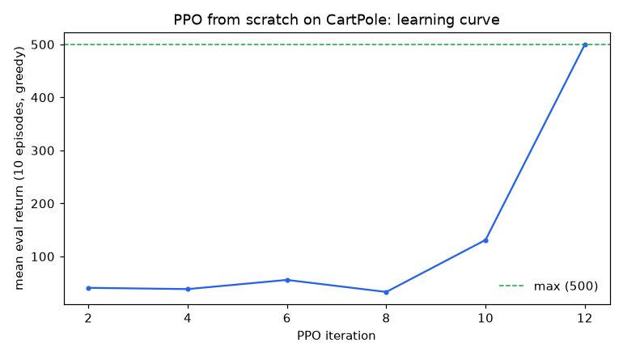
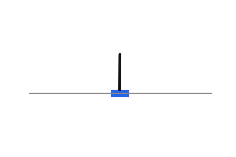

# ppolab

Proximal Policy Optimization, from scratch, in pure NumPy. No PyTorch, no JAX, no gym: the clipped surrogate objective, GAE(lambda), Adam, and the CartPole environment itself are all implemented from first principles, with every gradient checked against finite differences and every estimator checked against a brute-force reference.

## What's inside

- `src/ppolab/cartpole.py`: the classic cart-pole task written from the equations of motion (Euler integration, same constants as the standard benchmark). Termination is a real pole failure; hitting the 500-step time limit is a truncation that still bootstraps, and the two are kept apart because mixing them is a classic silent bug in RL code.
- `src/ppolab/nets.py`: a shared-trunk actor-critic MLP (4 -> 64 -> 64) with hand-written backprop through both heads.
- `src/ppolab/ppo.py`: the PPO loss (clipped surrogate + value MSE + entropy bonus) with derived analytic gradients, and GAE(lambda) advantage estimation.
- `src/ppolab/optim.py`: Adam.
- `src/ppolab/train.py`: the full loop: rollouts, advantage normalization, 10 epochs of minibatch updates, greedy evaluation, early stop on solve.

## Honest results

A single run (seed 0, 60-iteration cap, early stop on solve) reached mean greedy eval return **499.8 ± 0.6 over 10 episodes at iteration 12** and finished with **493.6 ± 27.7 over 20 episodes** (max is 500). Training took about 4 seconds of CPU time. Nothing here is tuned to flatter itself: the final 20-episode number is reported as measured, including the couple of episodes where the still-imperfect policy dropped the pole late.



The trained checkpoint ships in `assets/policy.npz`, and the test suite loads it and requires it to hold the pole for a mean of at least 400 steps, so the repo's headline claim is enforced by CI, not asserted in prose.



## Verification, not vibes

The test suite (18 tests, all passing) does the work prose can't:

- **Finite-difference gradient checks** on the full PPO loss (per-logit, per-value) and on every parameter of the actor-critic network end to end.
- **Brute-force GAE reference**: advantages match an explicit discounted sum of TD residuals, including rollouts cut by terminations mid-way.
- **Credit-assignment isolation**: reward before a `done` must not leak past it, and time-limit truncation must bootstrap exactly like an unbroken episode.
- **Clip semantics**: the objective caps at `(1+eps)*A` when the ratio runs away with positive advantage, the gradient is zero on the clipped branch, and with zero advantage the entropy term provably prefers the uniform policy.
- **Environment checks**: seeded determinism, real physics (constant right-pushing force ends the episode through the state boundary), and a random policy dying in under 200 steps.

## Run it

```bash
pip install numpy matplotlib pillow pytest
PYTHONPATH=src python -m pytest -q           # verification incl. the trained checkpoint
PYTHONPATH=src python -m ppolab.train --iters 60 --out assets   # retrain (~4s, CPU)
```

## Why it's interesting

Most from-scratch PPO write-ups stop at "it works". This repo makes the parts that usually stay implicit explicit and testable: the difference between termination and time-limit truncation in bootstrapping, where the clipped objective's gradient actually flows (and where it deliberately doesn't), and what GAE(lambda) does to credit assignment across episode boundaries. Every one of those behaviors has a test that would catch the standard implementation mistake.

## License

MIT

## v0.2: boundary fix and independent browser audit

The [live boundary inspector](https://midya8.github.io/ppolab/) computes the
entire shipped network and CartPole physics in scalar JavaScript. Replay all
30 original evaluation/gate initial states, inspect every step, or enter a
new state. These are newly computed scalar paths, not exact original NumPy
trajectories. Tight one-step checks do not imply matching long paths: the
reference run differed on 377 of 14,871 actions despite matching all 30 return
lengths. That divergence is reported, not suppressed or hidden behind a GIF.

The actual training collector had an internal-reset bug: time-limit truncation
used the next episode's reset value and let its advantage flow backward.
`collect_rollout` now retains the actual post-step value before reset, and
`compute_gae_transitions` uses separate bootstrap and trace masks. True failure
blocks both. External timeout bootstraps but stops the trace. The seven-array
legacy adapter still exists with explicitly documented reward augmentation;
its gamma must match the unchanged GAE caller. The new training path uses the
unambiguous transition API instead.

Ten GAE fixtures include four complete actual trajectories and six labeled
boundary controls. Inspect all 186 transition rows and every residual's credit
contribution. Sixteen PPO fixtures expose the advantage-sign-dependent clip
branch, all loss terms and output gradients. All 57 finite-difference stencils
are shown, including four clip-kink stencils with both one-sided slopes rather
than a false central-gradient guarantee. Strict editable JSON stays in the page.

```bash
python -m ppolab.audit gae --input examples/gae.json
python -m ppolab.audit ppo --input examples/ppo.json
node --test tests/*.cjs
bash examples/verify_wheel.sh
```

50 Python tests retain all 18 original tests, checkpoint and original artifacts.
Four Node/actual-Chrome tests check 26 complete reports/12,408 numeric values,
all 14,871 original observations for one-step network/physics agreement,
all 30 free-running selectors, contribution rows, four JSON exports, invalid
state clearing, keyboard controls and 320/390/1280 layouts. An independent
80-digit Decimal sum checks GAE; the unchanged NumPy loss checks all scalar
PPO derivatives. Installed reproduction checks eight module origins and runs
both JSON commands and the real training CLI outside the source checkout.

The corrected seed-0 full rerun reproduced the historical final return display,
but that single run is not evidence of better training or a speed benchmark.
No original checkpoint or measured result was replaced. PPO/GAE and CartPole
are standard methods, not new algorithms; clipping is not a hard KL constraint.
See [BOUNDARIES.md](BOUNDARIES.md) for the exact bug, equations, API/schema,
sources, numeric tolerances, finite-horizon interpretation and replay limits.
